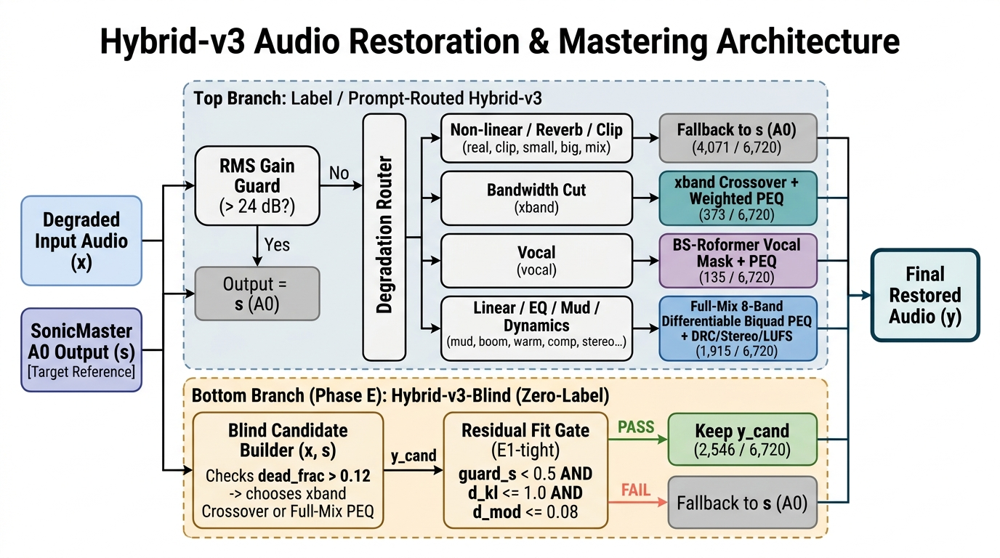
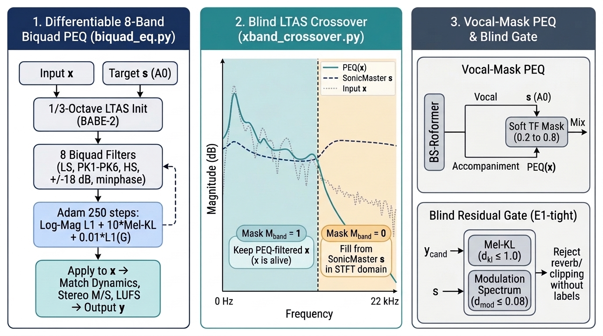

# Báo Cáo Tổng Quan: Phương Pháp Hybrid-v3 Cải Thiện Chất Lượng Phục Hồi Âm Nhạc Của SonicMaster

> **Tài liệu tóm tắt** — Trình bày ngắn gọn cơ chế hoạt động và kết quả thực nghiệm chính trên **6.720 đoạn nhạc kiểm thử độc lập**.

---

## 1. Bối Cảnh & Vấn Đề Cần Giải Quyết

**SonicMaster** là mô hình AI dùng để phục hồi và cân chỉnh lại các bản nhạc bị lỗi (bị tối tiếng, bị ù, bị vang phòng, sai âm lượng, mất dải âm…). Tuy nhiên, khi kiểm tra thực tế, nhóm phát hiện đầu ra của SonicMaster thường gặp một nhược điểm: **giọng hát và âm thanh chi tiết bị mờ, đôi khi nghe hơi "kim loại" hoặc nhân tạo**.

Nguyên nhân nằm ở cấu trúc xử lý của SonicMaster:
1. Âm thanh lỗi đi vào **Bộ nén (VAE Encoder)** để thu gọn thành dữ liệu nén.
2. Mô hình AI sửa lỗi trên dữ liệu nén này.
3. **Bộ giải nén (VAE Decoder)** khôi phục lại thành file âm thanh.

Chính quá trình **nén → giải nén** này làm thất thoát các chi tiết mịn của sóng âm gốc, khiến giọng hát mất độ tự nhiên ngay cả khi AI đã sửa đúng lỗi màu âm.

---

## 2. Cơ Chế Của Hybrid-v3

Ý tưởng cốt lõi của **Hybrid-v3** là: **Không dùng trực tiếp sóng âm do bộ giải nén tạo ra, mà chỉ mượn đầu ra của SonicMaster làm "bản mẫu hướng dẫn", rồi dùng bộ lọc âm thanh truyền thống (DSP) chỉnh thẳng lên bản nhạc gốc.**

Nhờ vậy, bản nhạc kết quả vừa đạt được cân bằng âm thanh như SonicMaster mong muốn, vừa giữ nguyên được **độ sắc nét và giọng hát tự nhiên của bản gốc** vì không phải đi qua khâu nén/giải nén.

### 2.1. Cách hệ thống xử lý từng trường hợp (Hybrid-v3)
Tùy theo loại lỗi của bản nhạc đầu vào, hệ thống tự động chọn 1 trong 4 hướng xử lý:

1. **Các lỗi cân bằng âm thanh & độ động (1.915 / 6.720 mẫu):**  
   Ví dụ: nhạc bị tối, bị chói, bị đục, bị ù, sai âm lượng, nén quá phẳng, hẹp không gian 2 tai nghe…  
   → Hệ thống mô phỏng một **bàn chỉnh âm thanh 8 nút vặn chuẩn phòng thu (Parametric EQ 8 băng tần)**, tự động tìm thông số tối ưu để chỉnh thẳng bản gốc sao cho có màu âm, độ nảy, độ rộng 2 loa và âm lượng khớp với bản mẫu của SonicMaster.
2. **Lỗi mất hẳn một vùng tần số (373 / 6.720 mẫu):**  
   Ví dụ: bản nhạc bị cắt mất sạch tiếng trầm hoặc tiếng cao.  
   → Vùng tần số nào bản gốc còn giữ được thì giữ nguyên bản gốc đã chỉnh; vùng nào bị mất hẳn thì lấy phần âm thanh tái tạo từ SonicMaster đắp vào đúng chỗ trống đó.
3. **Lỗi mất cân bằng giọng hát với nhạc nền (135 / 6.720 mẫu):**  
   → Dùng mô hình tách giọng hát riêng khỏi nhạc nền để xử lý hài hòa phần giọng và phần đệm, tránh làm biến dạng nhạc nền.
4. **Các lỗi quá nặng hoặc phi tuyến (4.297 / 6.720 mẫu):**  
   Ví dụ: tiếng vang phòng lớn, âm thanh bị rè vỡ đỉnh sóng, hoặc bản gốc bị vặn nhỏ gần như mất tiếng.  
   → Những lỗi này không thể sửa bằng nút vặn thông thường nên hệ thống giữ nguyên kết quả của SonicMaster.

### 2.2. Biến thể Hybrid-v3-Blind (Chạy tự động không cần biết trước tên lỗi)
Ở bản **Hybrid-v3** phía trên, hệ thống cần biết trước tên lỗi của từng đoạn nhạc để chia nhánh. Ngoài thực tế, người dùng thường chỉ đưa vào một file nhạc mà không gắn nhãn lỗi sẵn.

**Hybrid-v3-Blind** giải quyết bài toán này bằng cách:
- Tự chạy thử bộ chỉnh truyền thống lên bản nhạc gốc để tạo ra một bản nháp.
- Sau đó dùng một **bộ kiểm tra tự động** so sánh bản nháp với đầu ra của SonicMaster:
  - Nếu bản nháp khớp tốt (chứng tỏ đây là lỗi chỉnh được trực tiếp trên sóng gốc) → **giữ bản nháp** (tự động xử lý được **2.546 / 6.720** mẫu mà không cần bất kỳ nhãn lỗi nào).
  - Nếu không khớp (chứng tỏ có vang phòng hoặc méo nặng) → **tự động trả về bản của SonicMaster**.

---

## 3. Bảng Kết Quả So Sánh (Trên 6.720 Mẫu Kiểm Thử Độc Lập)

Để đánh giá toàn diện, kết quả được đo bằng 4 thước đo phổ biến nhất trong lĩnh vực phục hồi âm nhạc (so sánh với bản nhạc sạch chuẩn):

- **SSIM *(càng cao càng tốt)*:** Độ sắc nét và giống nhau về chi tiết phổ âm thanh so với bản sạch.
- **KL×1000 *(càng thấp càng tốt)*:** Độ sai lệch về phân bố năng lượng trầm–trung–cao so với bản sạch.
- **FAD-CLAP *(càng thấp càng tốt)*:** Khoảng cách về chất lượng âm nhạc tổng thể trong không gian mô hình AI nghe nhạc (`n = 5.306` mẫu).
- **Audiobox PQ *(càng cao càng tốt)*:** Điểm chất lượng thẩm mỹ âm thanh do mô hình của Meta chấm (thang tham chiếu: bản nhạc sạch chuẩn đạt `7.8882`).

| Thước đo | SonicMaster gốc (`A0`) | **Hybrid-v3** *(có nhãn lỗi)* | **Hybrid-v3-Blind** *(không cần nhãn)* | Ghi chú |
|---|---:|---:|---:|---|
| **SSIM** *(cao hơn = tốt hơn)* | 0.6092 | **0.7192** *(+0.1100)* | **0.7118** *(+0.1026)* | Cả hai đều giữ chi tiết sắc nét hơn hẳn SonicMaster gốc |
| — *Nhóm lỗi đơn (3.840 mẫu)* | 0.6242 | **0.7804** | **0.7669** | — |
| — *Nhóm lỗi kép/ba (2.880 mẫu)* | 0.5891 | **0.6375** | **0.6382** | — |
| **KL×1000** *(thấp hơn = tốt hơn)* | 0.8839 | **0.8902** *(tương đương)* | **0.8692** *(tốt nhất)* | Gần như không đánh đổi phân bố năng lượng; bản Blind còn tốt hơn bản gốc |
| — *Nhóm lỗi đơn (3.840 mẫu)* | 0.6923 | **0.6749** | **0.6533** | Đều tốt hơn SonicMaster gốc |
| — *Nhóm lỗi kép/ba (2.880 mẫu)* | 1.1393 | 1.1772 | 1.1572 | — |
| **FAD-CLAP** *(thấp hơn = tốt hơn)* | 0.0756 | **0.0398** *(giảm 47.4%)* | **0.0487** *(giảm 35.6%)* | Sai lệch chất lượng tổng thể giảm gần một nửa |
| **Audiobox PQ** *(cao hơn = tốt hơn)* | 7.7103 | **7.7132** *(+0.0029)* | 7.6093 *(-0.1010)* | **Hybrid-v3** nhỉnh hơn bản gốc; **Blind** giảm nhẹ do không tách riêng được một số ca giọng hát |
| **Kiểm tra riêng từng loại lỗi (19 loại)** | — | **Không có lỗi nào xấu đi** | **Không có lỗi nào xấu đi** | An toàn trên toàn bộ 19 loại lỗi |

---

## 4. Kết Luận Ngắn Gọn

1. **Hybrid-v3** khắc phục được điểm yếu làm mờ chi tiết của bộ nén SonicMaster mà **không cần huấn luyện lại mô hình AI**: độ sắc nét (`SSIM`) tăng mạnh từ `0.6092 → 0.7192`, sai lệch chất lượng (`FAD-CLAP`) giảm gần một nửa (`0.0756 → 0.0398`), điểm thẩm mỹ (`PQ`) còn nhỉnh hơn bản gốc và không làm tệ đi bất kỳ loại lỗi nào trong 19 loại lỗi.
2. **Hybrid-v3-Blind** chứng minh hướng đi hoàn toàn tự động **không cần nhãn lỗi** đạt kết quả rất sát (`SSIM = 0.7118`, `KL = 0.8692`, `FAD = 0.0487`), chỉ còn hạn chế nhẹ ở điểm thẩm mỹ `PQ` (`-0.1010`) do chưa có bước nhận diện riêng các đoạn có giọng hát.
3. *Lưu ý:* Các con số trên là kết quả đo bằng các chỉ số tự động; đánh giá cảm nhận trực tiếp của người nghe trên tập kiểm thử này là bước tiếp theo nếu cần xác nhận thêm.
