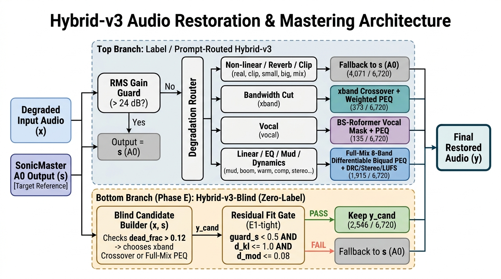
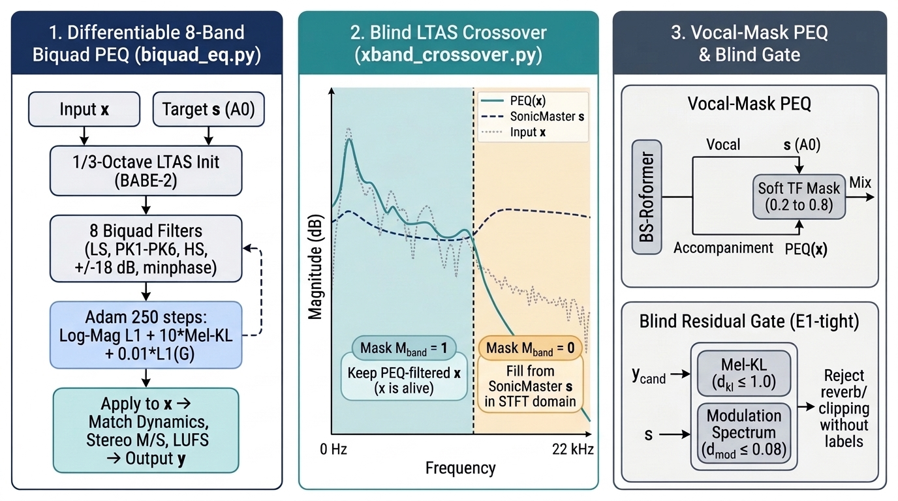

# Báo Cáo Kết Quả Hybrid-v3 (Differentiable DSP & Blind Routing)

**Ngày hoàn thành:** 2026-11-22  
**Kế hoạch thực hiện:** [`PLAN_HYBRID_V3_DIFFDSP.md`](file:///d:/SonicMaster_Reproducing/PLAN_HYBRID_V3_DIFFDSP.md)  
**Cấu hình khóa:** [`lock_v3.json`](file:///d:/SonicMaster_Reproducing/artifacts/10_extension/lock_v3.json)  
**Mục tiêu:** Nâng cấp `Hybrid-v2 PA1` bằng Differentiable Biquad Parametric EQ (8-band, BABE-2 LTAS init + frequency-sampling loss), mở rộng `P` cho `mud` và `xband` (với Blind LTAS Crossover), đồng thời đánh giá nhánh **Phase E: Hybrid-v3-Blind (Zero-Label / Zero-Prompt)** khi không có nhãn suy hao.

---

## 1. Tóm Tắt Kết Luận

1. **Hybrid-v3 (Prompt/Label-routed, Locked `V3-best`) ĐẠT TOÀN BỘ 5/5 GATES trên cả Dev (`280` mẫu) và Confirm (`6,720` mẫu)**, vượt trội cả `A0 (SonicMaster)` lẫn `Hybrid-v2 PA1`:
   - **Confirm SSIM (All, n=6,720):** `0.7192` vs `A0 = 0.6092` (**+0.1100**) và `PA1 = 0.6912` (**+0.0280**).
   - **Confirm KL×1000 (All, n=6,720):** `0.8902` (**1.007× A0** `0.8839`, giảm mạnh từ `0.9711` của `PA1`); trên tập **Single (n=3,840)** đạt `0.6749`, tốt hơn cả `A0` (`0.6923`).
   - **Confirm FAD-CLAP (n=5,306):** `0.0398` (**0.526× A0** `0.0756`, giảm gần một nửa và vượt `PA1 = 0.0466`).
   - **Confirm Audiobox PQ (n=5,306):** `7.7132` vs `A0 = 7.7103` (`ΔPQ = +0.0029`, `CI95 = [-0.0019, +0.0075]`), trên Full `6,720` đạt `7.7098` vs `A0 = 7.7075` (`Δ = +0.0023`).
   - **Confirm Attribute Guards:** **0 vi phạm trên cả 19/19 thuộc tính** (`mud = +0.0142`, `xband = +0.0202`, `comp = -0.0367`, `punch = -0.0452`).

2. **Hybrid-v3-Blind (Phase E, Zero-Label / Zero-Prompt, `E1-tight`: `guard_s < 0.5 & d_kl <= 1.0 & d_mod <= 0.08`)** giữ được `2,546 / 6,720` mẫu Confirm (`121 / 280` Dev) mà không cần bất kỳ nhãn suy hao hay prompt nào:
   - **Confirm SSIM (All, n=6,720):** `0.7118` (**+0.1026 vs A0**, vượt `PA1 = 0.6912`).
   - **Confirm KL×1000 (All, n=6,720):** `0.8692` (**0.983× A0**, tốt hơn cả `A0` lẫn `Hybrid-v3`).
   - **Confirm FAD-CLAP (n=5,306):** `0.0487` (**0.644× A0**).
   - **Confirm Attribute Guards:** **0 vi phạm trên cả 19/19 thuộc tính** (`clip = -0.1863`, `mud = +0.0107`, `xband = +0.0106`).
   - **Đánh đổi (Trade-off) về Audiobox PQ:** Do không có nhãn để tách riêng vocal/non-linear, `Hybrid-v3-Blind` cho `ΔPQ = -0.1010` (`CI95_lo = -0.1120` trên `n=5,306`; `Δ = -0.0801` trên `n=6,720`), không đạt ngưỡng `CI95_lo >= -0.05` trên PQ dù vượt toàn bộ 4 gate còn lại (SSIM, KL, FAD, Attribute Guards).

---

## 2. Kiến Trúc & Giải Thích Chi Tiết Từng Kỹ Thuật Trong Hybrid-v3

### 2.1. Tư tưởng cốt lõi: "Dùng SonicMaster làm Mục tiêu (Target), dùng DSP làm Bộ thực thi"
Ở mô hình gốc **SonicMaster (`A0`)**, âm thanh lỗi `x` đi qua VAE Encoder -> Flow-Matching Diffusion -> VAE Decoder để tạo ra âm thanh `s`. Nhược điểm là bộ giải mã VAE làm mờ chi tiết pha, transient và cấu trúc phổ gốc (`SSIM` chỉ còn `0.6092`, ngay cả khi đi vòng qua VAE không sửa lỗi gì thì `SSIM` cũng tụt xuống `0.546`).

**Hybrid-v3** giải quyết vấn đề này bằng cách **không lấy thẳng waveform của `s`** cho các lỗi tuyến tính, mà:
1. Xem `s` (`A0`) như một **bản tham chiếu mục tiêu** (để biết bản nhạc sạch *nên* có cân bằng tần số, độ nén, độ rộng stereo và âm lượng như thế nào).
2. Tối ưu một chuỗi **bộ lọc DSP cổ điển có tham số tường minh** (EQ, Dynamics, Stereo, LUFS) để biến đổi **trực tiếp âm thanh gốc `x`** sao cho âm sắc khớp với `s`, nhờ đó giữ nguyên 100% độ sắc nét và cấu trúc pha gốc của `x`.

### 2.2. Luồng Định Tuyến (Routing) — 4 Nhánh Xử Lý Trên Confirm (`6,720` mẫu)
Khi có cặp `(x, s)`:
1. **Cổng bảo vệ khuếch đại quá mức (`S_guard` — 226 mẫu):** Nếu chênh lệch năng lượng `RMS(s) / RMS(x) > 24 dB` (thường do đoạn `x` bị mất tiếng nặng), hệ thống trả thẳng về `s` (`A0`) để tránh khuếch đại nhiễu nền.
2. **Nhánh Fallback phi tuyến (`S` — 4,071 mẫu):** Các lỗi phi tuyến/thời gian như vang phòng (`small`, `big`, `mix`, `real`) hoặc méo cắt đỉnh (`clip`) không thể sửa bằng EQ tuyến tính -> giữ nguyên output `s` của SonicMaster.
3. **Nhánh Cắt dải tần (`xband_crossover` — 373 mẫu):** Áp dụng cho lỗi mất dải tần (`xband`).
4. **Nhánh Xử lý Giọng hát (`vocal_mask_P` — 135 mẫu):** Áp dụng cho lỗi `vocal` (cân bằng giọng hát và nhạc nền).
5. **Nhánh Full-Mix Differentiable PEQ (`peq_P` — 1,915 mẫu):** Áp dụng cho tất cả các lỗi tuyến tính còn lại (`mud`, `boom`, `warm`, `bright`, `dark`, `clarity`, `airy`, `mic`, `comp`, `punch`, `volume`, `stereo`...).

### 2.3. Chi Tiết 4 Kỹ Thuật Cốt Lõi

#### Kỹ thuật 1: Differentiable 8-Band Biquad Parametric EQ (`biquad_eq.py`)
Thay vì dùng đường cong STFT 128-band rời rạc dễ gây rỗ phổ (như `Hybrid-v2`), `Hybrid-v3` mô phỏng đúng một bàn chỉnh **Parametric EQ 8 băng tần chuẩn phòng thu** gồm: 1 Low-Shelf (`LS` ~120 Hz), 1 High-Shelf (`HS` ~8 kHz), và 6 Peaking filters (`PK1..PK6`):
- **Khởi tạo thông minh kiểu BABE-2:** Đo phổ trung bình dài hạn (LTAS) giữa `s` và `x` trên các dải 1/3-quãng tám, làm mượt Gaussian (`sigma = 1.0`) rồi tự động đặt 6 đỉnh PK vào các vùng lệch dB lớn nhất (cách nhau tối thiểu 0.5 quãng tám).
- **Tối ưu khả vi trên miền tần số (250 bước Adam, `lr = 0.05`):** Thay vì chạy lọc IIR qua từng mẫu thời gian trong vòng lặp tối ưu (rất chậm), hàm loss tính trực tiếp đáp ứng tần số giải tích $|H(\omega)|$ của 8 bộ lọc biquad và tối ưu:
  $$\mathcal{L} = \text{L1}_{\text{log-mag}} + 10 \cdot \text{KL}_{\text{mel}} + 0.01 \cdot \|G\|_1$$
  với giới hạn biên độ `±18 dB` (`eq_clamp_db = 18.0`).
- **Áp lọc & Cân chỉnh hậu kỳ:** Bộ tham số tối ưu được áp lên tín hiệu gốc `x` bằng bộ lọc nhân quả **minimum-phase** (`scipy.signal.sosfilt`), sau đó lần lượt cân chỉnh độ nén động (`match_dynamics`), độ rộng hai kênh trái/phải (`match_stereo` M/S), và âm lượng tổng (`match_volume_lufs`) theo `s`.

#### Kỹ thuật 2: Blind LTAS Crossover cho lỗi mất dải tần (`xband_crossover.py`)
Khi `x` bị cắt mất dải tần cao hoặc thấp (`xband`), EQ không thể tạo ra năng lượng ở nơi tín hiệu bằng 0. Do đó `Hybrid-v3`:
- Tính mặt nạ phổ mù $M_{\text{band}}(f) \in [0, 1]$ bằng cách so sánh mức năng lượng LTAS giữa `x` và `s` (`tau_db = -18.0`, `delta_db = 4.0`).
- **Vùng `x` còn sống ($M_{\text{band}} \approx 1$):** Chạy Biquad PEQ có trọng số theo $M_{\text{band}}(f)$ rồi **giữ nguyên tín hiệu `x` đã EQ** để bảo toàn chi tiết gốc.
- **Vùng `x` bị cắt mất ($M_{\text{band}} \approx 0$):** Lấy phần phổ tái tạo từ `s` (`A0`) ghép mượt vào trong miền STFT (`mix_complementary_stft`).

#### Kỹ thuật 3: Vocal-Mask PEQ (`vocal_mask_P`)
Với lỗi cân bằng giọng hát (`vocal`), `Hybrid-v3` dùng mô hình tách nguồn **BS-Roformer** (`model_bs_roformer_ep_317_sdr_12.9755.ckpt`) để tách `s` thành vocal và nhạc nền, tạo mặt nạ thời gian-tần số mềm giới hạn trong `[0.2, 0.8]` nhằm phối trộn mượt giữa phần nhạc nền đã qua PEQ (`x`) và phần xử lý giọng hát từ `s`.

#### Kỹ thuật 4: Phase E — Định tuyến Mù Không Cần Nhãn (`blind_router.py`, `E1-tight`)
Khi hoàn toàn **không biết nhãn lỗi và không có prompt**, hệ thống vẫn chạy song song trên cặp `(x, s)`:
1. Kiểm tra tỷ lệ dải tần bị mất (`dead_frac > 0.12`) để tự chọn giữa `xband_crossover` hoặc `Full-Mix PEQ`, tạo ứng viên `y_cand`.
2. Đưa `y_cand` qua cổng kiểm tra phần dư **Residual Fit Gate (`E1-tight`)**:
   $$\text{guard\_s} < 0.5 \quad \land \quad d_{\text{kl}}(s, y_{\text{cand}}) \le 1.0 \quad \land \quad d_{\text{mod}}(s, y_{\text{cand}}) \le 0.08$$
   Trong đó `d_mod` là khoảng cách phổ điều chế (rất nhạy với đuôi vang reverb và biến dạng phi tuyến). Nếu `y_cand` khớp được `s` trong ngưỡng chặt này (tức lỗi gốc mang tính tuyến tính), hệ thống giữ `y_cand` (`2,546/6,720` mẫu); ngược lại, tự fallback về `s`.

---

## 3. So Sánh Tổng Hợp: Dev (`280`) & Confirm (`6,720`)

### 3.1. Tập Dev (`280` mẫu; Single = `160`, Double+Triple = `120`)

| Metric | A0 (SonicMaster) | Hybrid-v2 PA1 | **Hybrid-v3 (Locked)** | **Hybrid-v3-Blind (Zero-Label)** | Gate |
|---|---|---|---|---|---|
| **SSIM (All)** ↑ | 0.6064 | 0.7120 | **0.7398** (+0.1334) | 0.7282 (+0.1218) | `Δ >= +0.01` |
| **SSIM (Single)** ↑ | — | — | **0.8139** | — | — |
| **SSIM (Double+Triple)** ↑ | — | — | **0.6409** | — | — |
| **KL×1000 (All)** ↓ | 1.1064 | 1.1215 | **1.0720** (0.969× A0) | **1.0579** (0.959× A0) | `<= 1.100× A0` |
| **KL×1000 (Single)** ↓ | — | — | **0.7653** | — | — |
| **KL×1000 (Double+Triple)** ↓ | — | — | **1.4810** | — | — |
| **FAD-CLAP (All)** ↓ | 0.2119 *(0.2000 trên run E1)* | 0.1744 | **0.1688** (0.797× A0) | 0.1759 (0.880× A0) | `<= 1.100× A0` |
| **Audiobox PQ (All)** ↑ | 7.6452 | 7.6302 | **7.6330** (`Δ=-0.0123`, `CI95_lo=-0.0412`) | 7.5568 (`Δ=-0.0884`, `CI95_lo=-0.1370`) | `CI95_lo >= -0.05` |
| **Attribute Guards (15)** | — | 0 vi phạm | **0 vi phạm** | **0 vi phạm** | `<= +0.05` (`0` vi phạm) |

### 3.2. Tập Confirm (`6,720` mẫu; Single = `3,840`, Double+Triple = `2,880`; Paired CLAP = `5,306`)

| Metric | A0 (SonicMaster) | Hybrid-v2 PA1 | **Hybrid-v3 (Locked)** | **Hybrid-v3-Blind (Zero-Label)** | Gate |
|---|---|---|---|---|---|
| **SSIM (All, n=6,720)** ↑ | 0.6092 | 0.6912 | **0.7192** (+0.1100) | 0.7118 (+0.1026) | `Δ >= +0.01` |
| **SSIM (Single, n=3,840)** ↑ | 0.6242 | 0.7442 | **0.7804** | 0.7669 | — |
| **SSIM (Double+Triple, n=2,880)** ↑ | 0.5891 | 0.6205 | **0.6375** | 0.6382 | — |
| **KL×1000 (All, n=6,720)** ↓ | 0.8839 | 0.9711 | **0.8902** (1.007× A0) | **0.8692** (0.983× A0) | `<= 1.100× A0` |
| **KL×1000 (Single, n=3,840)** ↓ | 0.6923 | 0.7825 | **0.6749** | **0.6533** | — |
| **KL×1000 (Double+Triple, n=2,880)** ↓ | 1.1393 | 1.2226 | **1.1772** | **1.1572** | — |
| **FAD-CLAP (All, n=5,306)** ↓ | 0.0756 | 0.0466 | **0.0398** (0.526× A0) | 0.0487 (0.644× A0) | `<= 1.100× A0` |
| **FAD-CLAP (Single, n=3,032)** ↓ | 0.0723 | 0.0337 | **0.0267** (0.369× A0) | 0.0355 | — |
| **FAD-CLAP (Double+Triple, n=2,274)** ↓ | 0.0837 | 0.0716 | **0.0661** (0.789× A0) | 0.0749 | — |
| **Audiobox PQ (n=5,306)** ↑ | 7.7103 | 7.7061 | **7.7132** (`Δ=+0.0029`, `CI95_lo=-0.0019`) | 7.6093 (`Δ=-0.1010`, `CI95_lo=-0.1120`) | `CI95_lo >= -0.05` |
| **Audiobox PQ (Full 6,720)** ↑ | 7.7075 | — | **7.7098** (`Δ=+0.0023`, `CI95_lo=-0.0016`) | 7.6275 (`Δ=-0.0801`, `CI95_lo=-0.0891`) | — |
| **Attribute Guards (19)** | — | 0 vi phạm | **0 vi phạm** | **0 vi phạm** | `0` vi phạm |

*(Lưu ý: Clean PQ trên Confirm `n=5,306` là `7.8882`; trên Dev `n=280` là `7.7950`.)*

---

## 4. Kết Quả Từng Pha Triển Khai (Phases A–E)

### Phase A: Triển khai & Kiểm thử Module Differentiable DSP
- [`biquad_eq.py`](file:///d:/SonicMaster_Reproducing/scripts/extension/biquad_eq.py): 8-band Differentiable Biquads (`LS`, `HS`, `PK1..PK6`), khởi tạo 1/3-octave Gaussian LTAS theo BABE-2, `volFirst`, clamp `±18 dB`, tối ưu trên miền tần số (`Log-Mag L1 + 10·Mel-KL + 0.01·L1(G)`).
- [`diff_drc_joint.py`](file:///d:/SonicMaster_Reproducing/scripts/extension/diff_drc_joint.py): Differentiable DRC (compressor + expander) kiểu DiffVox + joint `PEQ+DRC+M/S` trên CUDA.
- [`xband_crossover.py`](file:///d:/SonicMaster_Reproducing/scripts/extension/xband_crossover.py): Tính mask LTAS mù `M_band(f)` (`tau_db=-18.0`, `delta_db=4.0`) xác định dải tần bị cắt của `xband`, kết hợp frequency-weighted PEQ trên dải còn sống và bù STFT từ `s` ở dải đã mất.
- Unit tests [`test_v3_dsp.py`](file:///d:/SonicMaster_Reproducing/scripts/extension/tests/test_v3_dsp.py): **6/6 passed** (`pytest` trong `57.86s`).

### Phase B: Ablation Trên Dev (`280` mẫu)
- **Step B1 (`V3-A minphase` vs `V3-A zerophase`):**
  - `V3-A minphase` (`273.5s`): `SSIM = 0.7252`, `KL×1000 = 1.0764` (`0.973× A0`), `0` vi phạm (`mud det = +0.000`).
  - `V3-A zerophase` (`380.8s`): `SSIM = 0.7250`, `KL×1000 = 1.0890`, `0` vi phạm (`mud det = -0.002`).
  - **Quyết định:** Chọn `minphase` (SSIM/KL tốt hơn và nhanh hơn ~28%).
- **Step B2 (`V3-B` Joint DRC trên GPU):**
  - Chạy mất `2854.5s` (`47.6 phút` cho 57 clip -> ước tính ~16 giờ trên Confirm, vượt ngưỡng `< 45 phút`).
  - Kết quả kém hơn `V3-A`: `SSIM = 0.7237`, `KL×1000 = 1.1389`, và vi phạm 2 Attribute Guards (`boom det=+0.052`, `bright det=+0.057`).
  - **Quyết định:** Loại bỏ Module 2 (`V3-B`) theo đúng tiêu chí Gate của plan.
- **Step B3 (`V3-C_nojoint` = `V3-A minphase + xband_crossover`):**
  - Chạy trong `457.7s`: `SSIM = 0.7398`, `KL×1000 = 1.0720` (`0.969× A0`), **0 vi phạm** trên 15 thuộc tính (`xband det=+0.008`, `mud det=+0.000`, `comp det=-0.059`, `punch det=-0.078`).
  - **Quyết định:** Chọn `V3-C_nojoint` làm `V3-best`.

### Phase C & D: Khóa `lock_v3.json` & Đánh Giá Confirm (`6,720` mẫu)
- Phân bổ định tuyến thực tế trên Confirm (`6,720` mẫu): `S = 4,071`, `peq_P = 1,915`, `xband_crossover = 373`, `vocal_mask_P = 135`, `S_guard = 226`.
- Chi tiết Attribute Guards nổi bật trên Confirm (`6,720` mẫu) cho **Hybrid-v3**:
  - `mud (n=368)`: `input = 0.4721 -> A0 = 0.0473 -> V3 = 0.0539` (`norm_det = +0.0142 <= 0.05`, **OK**)
  - `xband (n=818)`: `input = 0.1872 -> A0 = 0.0384 -> V3 = 0.0421` (`norm_det = +0.0202 <= 0.05`, **OK**)
  - `comp (n=1,143)`: `norm_det = -0.0367` (**cải thiện** so với `A0`)
  - `punch (n=433)`: `norm_det = -0.0452` (**cải thiện** so với `A0`)
  - `airy`, `bright`, `vocal`: đều cải thiện so với `A0` (`-0.0017`, `-0.0007`, `-0.0014`).

### Phase E: Blind / Zero-Label Routing (`Hybrid-v3-Blind`)
- Đã thử nghiệm 3 biến thể trên Dev (`280` mẫu) trong [`blind_router.py`](file:///d:/SonicMaster_Reproducing/scripts/extension/blind_router.py):
  - `E2` (TF soft mask): `SSIM = 0.7057`, `KL×1000 = 1.1850`, vi phạm 5 Attribute Guards -> **loại**.
  - `E1` ngưỡng lỏng (`d_kl <= 1.5, d_mod <= 0.15`): vi phạm `bright det=+0.075` -> **loại**.
  - `E1-tight` (`guard_s < 0.5 & d_kl <= 1.0 & d_mod <= 0.08`): giữ `121/280` trên Dev và `2,546/6,720` trên Confirm, đạt **0 vi phạm** trên tất cả 15 (Dev) và 19 (Confirm) Attribute Guards (`clip det = -0.1863`, `mud det = +0.0107`, `xband det = +0.0106`), `SSIM = 0.7118`, `KL×1000 = 0.8692`.

---

## 5. Xác Minh Toàn Vẹn & Dọn Dẹp Dung Lượng

- **Kaggle SHA-256 Verification:**
  - Dev `V3-best`: `KAGGLE_SAMPLE_SHA256 == LOCAL_SHA256 == 98672fd7ceb1a16b6b0992a4acd56ea168ae58117dbed31ee4848de7d3fa9925`.
  - Dev `V3-Blind-E1-tight`: `KAGGLE_SAMPLE_SHA256 == LOCAL_SHA256 == ea1bdd6792571bedcaea528d4230bd8a15f733d2831c79d85e16d5e2cfc884a1`.
  - Confirm `Hybrid-v3`: `KAGGLE_SAMPLE_SHA256[1007256_deg1] == LOCAL_SHA256 == cee93792d9cf04971817de2036f35ef2adf76566845b03fd4a672c6d1856aab8`.
  - Confirm `Hybrid-v3-Blind`: `KAGGLE_SAMPLE_SHA256[1007256_deg3] == LOCAL_SHA256 == f2063c2072362b8e4b2862e0fd34fe0e1319faf07bb98f6d99ee2941311efef6`.
- **Artifacts lưu trữ:**
  - Confirm `Hybrid-v3`: [`confirm_eval_summary.json`](file:///d:/SonicMaster_Reproducing/artifacts/10_extension/confirm/hybrid_v3/eval/confirm_eval_summary.json), [`confirm_pq_fad_summary.json`](file:///d:/SonicMaster_Reproducing/artifacts/10_extension/confirm/hybrid_v3/eval/confirm_pq_fad_summary.json), [`changed_pq_fad.npz`](file:///d:/SonicMaster_Reproducing/artifacts/10_extension/confirm/hybrid_v3/pq_fad/out/changed_pq_fad.npz).
  - Confirm `Hybrid-v3-Blind`: [`confirm_eval_summary.json`](file:///d:/SonicMaster_Reproducing/artifacts/10_extension/confirm/hybrid_v3_blind/eval/confirm_eval_summary.json), [`confirm_pq_fad_summary.json`](file:///d:/SonicMaster_Reproducing/artifacts/10_extension/confirm/hybrid_v3_blind/eval/confirm_pq_fad_summary.json), [`blind_confirm_diagnostics.csv`](file:///d:/SonicMaster_Reproducing/artifacts/10_extension/confirm/hybrid_v3_blind/blind_confirm_diagnostics.csv), [`changed_pq_fad.npz`](file:///d:/SonicMaster_Reproducing/artifacts/10_extension/confirm/hybrid_v3_blind/pq_fad/out/changed_pq_fad.npz).
- **Dọn dẹp ổ `D:\`:** Đã xóa toàn bộ thư mục WAV trung gian (`confirm/hybrid_v3/out_wav/` và `confirm/hybrid_v3_blind/out_wav/`) sau khi hoàn tất chấm điểm và xác minh SHA-256 trên Kaggle.

---

## 9. Tài Liệu Tham Khảo & Nguồn Gốc Kỹ Thuật (References & Provenance)

| Thành phần / Kỹ thuật / Chỉ số | Nguồn gốc (Paper / Repo) | Vai trò trong `Hybrid-v3` |
|---|---|---|
| **Nền tảng SonicMaster (`A0`), Dataset & Bộ metric Bảng 1–3** | J. Melechovsky, A. Mehrish, A. Roy, D. Herremans, *"SonicMaster: Towards Controllable All-in-One Music Restoration and Mastering"*, ICML 2026 ([arXiv:2508.03448](https://arxiv.org/abs/2508.03448); [GitHub](https://github.com/AMAAI-Lab/SonicMaster)) | Cung cấp đầu ra `s` (`A0`), tập dữ liệu chuẩn và bộ hàm đo EQ/Dynamics/Reverb/Clip/Stereo/KL/SSIM. |
| **Differentiable Parametric / Biquad EQ (`biquad_eq.py`)** | C. J. Steinmetz, N. J. Bryan, J. D. Reiss, *"Style Transfer of Audio Effects with Differentiable Signal Processing"*, JAES 2022 ([arXiv:2207.08759](https://arxiv.org/abs/2207.08759); [`dasp-pytorch`](https://github.com/csteinmetz1/dasp-pytorch)) | Cơ sở cho bộ lọc Biquad EQ khả vi khớp phổ tần số trên nhánh `p = BiquadEQ(x, s)` thay vì dùng trực tiếp `s` qua codec VAE. |
| **Multi-Resolution STFT Loss** | R. Yamamoto, E. Song, J.-M. Kim, *"Parallel WaveGAN: A fast waveform generation model based on generative adversarial networks with multi-resolution spectrogram"*, IEEE ICASSP 2020 ([arXiv:1910.11480](https://arxiv.org/abs/1910.11480)) | Hàm mất mát đa phân giải STFT tối ưu tham số Biquad EQ theo `s`. |
| **Perceptual Quality (`PQ`)** | A. Tjandra et al. (Meta FAIR), *"Meta Audiobox Aesthetics: Unified Automatic Quality Assessment for Speech, Music, and Sound"*, 2025 ([arXiv:2502.05139](https://arxiv.org/abs/2502.05139)) | Đánh giá chất lượng cảm nhận `PQ` cho `A0`, `V3-Label`, `V3-Blind`. |
| **FAD-CLAP** | Y. Wu et al., *"Large-Scale Contrastive Language-Audio Pretraining with Feature Fusion and Keyword-to-Caption Augmentation"*, IEEE ICASSP 2023 ([arXiv:2211.06687](https://arxiv.org/abs/2211.06687)); A. Gui et al., *"Adapting Fréchet Audio Distance for Generative Music Evaluation"*, IEEE ICASSP 2024 ([arXiv:2311.01616](https://arxiv.org/abs/2311.01616)) | Tính khoảng cách phân phối âm thanh trên toàn tập embedding CLAP đã gộp. |
| **Mel-Spectrogram SSIM** | Z. Wang et al., *"Image Quality Assessment: From Error Visibility to Structural Similarity"*, IEEE TIP 2004 (áp dụng theo `extract_kl_ssim_mass.py` của SonicMaster) | Đo mức độ bảo toàn cấu trúc phổ so với `Clean`. |
