# Methodology

## System overview

Hybrid-v4.4 is a SonicMaster-guided system for restoring stereo music at 44.1 kHz. Given a degraded waveform $x$ and an optional restoration prompt $p$, a frozen SonicMaster produces a preliminary restoration $s=\operatorname{SonicMaster}(x,p)$. Hybrid-v4.4 receives both waveforms. It uses $s$ as guidance and retains a direct signal path from $x$ through the short-time Fourier transform (STFT), spectral processing, and inverse STFT. Along this path, the original waveform bypasses the SonicMaster audio codec. During training, the paired clean waveform $c$ serves as the supervision target. Inference requires $x$ and the corresponding SonicMaster output $s$. [SonicMaster](https://arxiv.org/html/2508.03448v5) · [Hybrid-v4 implementation](scripts/extension/v4_models.py#L429)

```mermaid
flowchart LR
    X["Degraded stereo waveform x"] --> SM["Frozen SonicMaster"]
    P["Restoration prompt p"] --> SM
    SM --> S["Preliminary restoration s"]
    X --> A["Align waveforms and normalize levels"]
    S --> A
    A --> Z["Mid/Side STFT"]
    Z --> E["Power compression<br/>Dual scale-aware band encoder"]
    E --> B["Four dual-axis blocks"]
    B --> H["Predict MF9 coefficients, gate, and residual"]
    Z -->|"Linear complex spectra Zx and Zs"| D["Filter input, blend with guidance,<br/>and add the complex residual"]
    H --> D
    D --> Y["Inverse STFT, stereo reconstruction,<br/>overlap-add, and RMS matching"]
    Y --> O["Restored stereo waveform"]
```

*Figure 1. Hybrid-v4.4 inference pipeline. The feature path estimates the spectral corrections. The direct path supplies the complex input and guidance spectra to which those corrections are applied.*

## Waveform alignment and time–frequency representation

The preprocessing stage estimates a global sample lag by cross-correlating mono downmixes of $x$ and $s$ within a ±512-sample search range. It shifts both channels of $s$ by the same lag and zero-pads the exposed boundary. This aligns corresponding events before complex-domain blending. Track-level RMS normalization then puts the two waveforms on a comparable amplitude scale. The encoder also receives the original log-RMS of each waveform and their level difference. [Waveform alignment](scripts/extension/v4_alignment.py) · [Track normalization](scripts/extension/v4_models.py#L74)

The normalized stereo waveforms are converted to Mid/Side using $M=(L+R_{\mathrm{ch}})/\sqrt{2}$ and $S=(L-R_{\mathrm{ch}})/\sqrt{2}$, where $L$ and $R_{\mathrm{ch}}$ are the left and right channels. A Hann-window STFT with a 2,048-sample window and a 512-sample hop yields 1,025 one-sided frequency bins per channel. Let $Z_x$ and $Z_s$ denote the resulting complex spectra. The encoder receives power-compressed copies, with exponent $0.3$ applied to their magnitudes while preserving phase. The decoder operates on $Z_x$ and $Z_s$ at their original spectral scale after waveform normalization. [Mid/Side conversion and STFT](scripts/extension/v4_models.py#L24) · [Forward pass](scripts/extension/v4_models.py#L476)

## Dual scale-aware encoder and backbone

The encoder partitions the spectrum into 24 nonuniform frequency bands. For each band and frame, it normalizes the compressed spectra of $x$ and $s$ separately by their respective band RMS values. It then concatenates the normalized real and imaginary components with seven scale features. Four describe the local spectral levels and stereo relationship. They include the two log band RMS values, their log ratio, and the difference between the two log Side-to-Mid RMS ratios. The remaining three describe the track-level RMS values and their difference.

For a band of width $W_b$, the resulting $8W_b+7$ features are projected to a 64-dimensional token using band-specific LayerNorm, a linear layer, and SiLU. This produces a $B\times T\times24\times64$ tensor, where $B$ is batch size and $T$ is the number of STFT frames. The normalized components describe the spectral structure within each band, while the scale features allow the model to distinguish a naturally quiet band from a band whose energy differs between $x$ and $s$. [Band encoder](scripts/extension/v4_models.py#L105)

Four dual-axis blocks process the encoded features. Each block uses four-head self-attention across the 24 bands within each frame, followed by a bidirectional GRU across frames within each band. The GRU output is projected to 64 dimensions and refined by a dense feed-forward network with dimensions $64\rightarrow256\rightarrow64$. Cross-band attention provides context for spectral relationships, while the GRU captures how these relationships evolve within a chunk. [Dual-axis backbone](scripts/extension/v4_models.py#L198)

## Multi-frame complex decoder

The decoder predicts a multi-frame filter, a guidance gate, and an additive complex residual. For frequency bin $f$ and frame $t$, let $Z_x(f,t)\in\mathbb C^2$ be the Mid/Side vector. The filtered input is

$$
F(Z_x)(f,t)=Z_x(f,t)+
\sum_{k\in\mathcal K}\Delta W_k(f,t)\,Z_x(f,t+k),
\qquad
\mathcal K=\{-18,-12,-8,-5,-3,-2,-1,0,1\}.
$$

Each $\Delta W_k(f,t)\in\mathbb C^{2\times2}$ can adjust magnitude and phase and mix information between Mid and Side. The zero-offset matrix is predicted for each frequency bin. For the other eight offsets, bins within the same subband share the filter coefficients. The tap offsets span approximately 221 ms at the configured STFT hop. [MF9 decoder](scripts/extension/v4_models.py#L276)

The final complex spectrum is

$$
\widehat Z=(1-g)\odot F(Z_x)+g\odot Z_s+R,
\qquad g=\sigma(g_{\mathrm{raw}}+b_g).
$$

Here $\odot$ denotes element-wise multiplication. The gate $g$ sets how much of the SonicMaster spectrum is used at each time–frequency bin and Mid/Side channel. The complex residual $R$ adds a learned correction after blending. Its amplitude is scaled using the joint energy of $Z_x$ and $Z_s$ within each band and frame. This additive path can supply a correction even when the corresponding input coefficient is close to zero. For example, if the input Side channel is weak, the decoder can use cross-channel filtering from Mid, the Side component of $s$, and the predicted Side residual. [Complex filtering, gate, and residual](scripts/extension/v4_models.py#L324)

Inverse STFT and the inverse Mid/Side transform recover the stereo waveform. At inference, long signals are processed in 8-second chunks with 50% overlap and Hann-weighted overlap-add. The output is then matched to the track-level RMS of the aligned SonicMaster waveform. [Waveform reconstruction](scripts/extension/v4_models.py#L512)

## Training objective

The pilot used 2,800 degraded clips from 400 source tracks for training and 560 clips from 80 separate source tracks for validation. Each source track contributed seven degraded variants. The trainer sampled aligned four-second crops and selected the checkpoint with the lowest validation MR-STFT loss. [Pilot split](artifacts/10_extension/v4/pilot_splits.json) · [Training script](artifacts/10_extension/v4/kaggle_kernel_pilot_train/train_pilot.py#L753)

The model is supervised with paired clean audio. The initial v4.4 objective combines multi-resolution STFT loss, compressed complex STFT loss, waveform L1 loss, and a Mel loss.

$$
\mathcal L_{\mathrm{initial}}
=\mathcal L_{\mathrm{MRSTFT}}
+0.5\mathcal L_{\mathrm{complex}}
+0.5\mathcal L_{\mathrm{waveform}}
+2.5\mathcal L_{\mathrm{mel}}.
$$

The multi-resolution term compares both Left/Right and Mid/Side spectra at FFT sizes of 512, 1,024, and 2,048. The compressed complex term compares real and imaginary STFT components. The Mel term combines $D_{\mathrm{KL}}(p_{\mathrm{clean}}\|p_{\mathrm{out}})$ over normalized average Mel-band energies with log-Mel L1. From epoch 13, the pilot adds an L1 loss on the output and reference Side-to-Mid RMS ratios with a weight of 1.0. [Loss implementation](scripts/extension/v4_losses.py) · [Pilot training configuration](artifacts/10_extension/v4/kaggle_kernel_pilot_train/train_pilot.py#L825)

## Architectural relationship to NPU-ASLP

NPU-ASLP provides two architectural ideas used in v4.4. First, its **scale-aware band encoder** combines a normalized complex band spectrum with its log-RMS. Hybrid-v4 extends that design to two stereo waveforms, retaining level cues from both and adding their relative level and stereo differences. Second, NPU-ASLP processes **frequency and time as separate axes**. Hybrid-v4 retains that organization using cross-band attention, a temporal BiGRU, and a dense feed-forward network. [NPU-ASLP, Section 2.1](https://arxiv.org/html/2610.15464v1) · [Hybrid-v4 encoder and backbone](scripts/extension/v4_models.py#L105)

NPU-ASLP also motivated the **complex-mapping variants v4.0 and v4.1**. In those variants, the decoder predicted a complex correction to the compressed input spectrum. From v4.2 onward, Hybrid-v4 uses a multi-frame filter and SonicMaster guidance in the uncompressed complex STFT domain. V4.4 adds the band-scaled complex residual to this decoder. NPU-ASLP's **Top-1 mixture of experts** informs the proposed v4.5 backbone. The evaluated v4.4 backbone uses dense feed-forward layers. [NPU-ASLP, complex spectral mapping and TF-MoE](https://arxiv.org/html/2610.15464v1) · [Hybrid-v4 variant definitions](scripts/extension/v4_models.py#L237) · [V4.5 design](PLAN_HYBRID_V4.md#L130)
